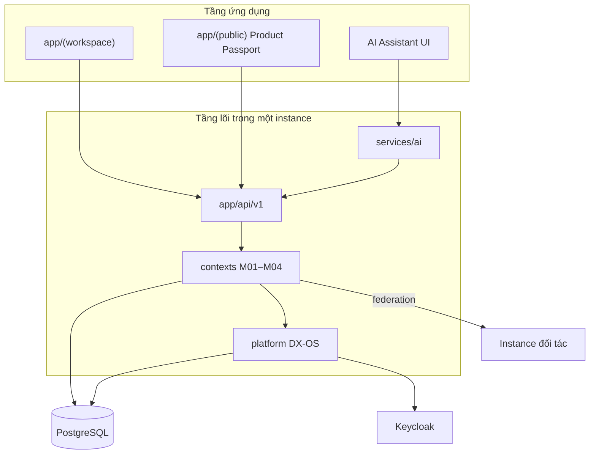

# Kiến trúc Nexora

Nexora là ERP nguồn mở self-hosted, tích hợp truy xuất nguồn gốc và liên thông chuỗi cung ứng (federated). Một tiến trình Next.js phục vụ UI và API (Modular Monolith). Mỗi doanh nghiệp chạy một instance với một PostgreSQL riêng.

Nguồn chân lý phạm vi: **Chương 6**. Tech stack: **Chương 7 §7.12**. Chi tiết Agent: `documents/referents/`.

## Ba tầng

## Module MVP

| Mã | Trách nhiệm | Code |
| --- | --- | --- |
| Platform | Identity, access, audit, workflow, outbox, files | `platform/` |
| M01 | Tổ chức, user, partner, connection | `contexts/system/` |
| M02 | Product, batch, warehouse, tồn | `contexts/catalog/`, `contexts/inventory/` |
| M03 | Nhập/xuất/chuyển/kiểm kê/bán theo lô | `contexts/trading/` |
| M04 | Trace events, QR, federation | `contexts/traceability/`, `contexts/federation/` |
| AI01 | Tra cứu, draft, cảnh báo rule-based | `services/ai/` |

Thứ tự phụ thuộc: xem `documents/plans/DEPENDENCIES.md`.

## Tech stack (Chương 7.12)

| Lớp | Công nghệ |
| --- | --- |
| UI | Next.js, React, TypeScript, Tailwind, shadcn/ui |
| Biên & định danh | Keycloak (OIDC), REST, HTTPS |
| Nghiệp vụ | Next.js Modular Monolith, DDD, PostgreSQL |
| Quy trình & CI | Flowable, GitHub Actions, Docker Compose |
| Dữ liệu & hàng đợi | PostgreSQL, Redis, object storage S3/R2-compatible |
| AI | Python, REST, LLM (tool-calling) |
| Quan sát | OpenAPI, Prometheus, Grafana |

## Luật kiến trúc

- `app/` không chứa rule nghiệp vụ.
- `platform/` không chứa tên chứng từ M02–M04.
- Context không import domain của nhau; wire ở `composition/`.
- Confirm chứng từ: một transaction ghi aggregate + tồn (qua port) + outbox + audit.
- Nhận federation message không đồng nghĩa đã nhận đủ hàng.
- AI chỉ Draft; người dùng Confirm.
- Không dùng mô hình SaaS `tenant_id` đa tổ chức trên một DB. Chi nhánh/kho là dữ liệu nội bộ của một org.

## PostgreSQL (một instance)

Schema gợi ý: `platform`, `system`, `catalog`, `inventory`, `trading`, `traceability`, `federation`.

## Triển khai

Docker Compose: app, PostgreSQL, Redis, Keycloak, storage, Flowable (và AI service khi bật). Demo liên thông: ba stack A/B/C, DB riêng, chỉ nói chuyện qua Federation API.

## Tài liệu liên quan

- `documents/referents/SOURCE_OF_TRUTH.md`
- `documents/referents/FOLDER_STRUCTURE.md`
- `documents/referents/CODING_RULES.md`
- `documents/plans/*`
- Đề xuất: `documents/nexora/Nexora - NEU.OPUS5.5.md` (Ch6, Ch7)

## Scaffold lệch (không chuẩn)

Các context cũ kiểu `sales`, `finance`, `procurement`, `master-data` (nếu còn trong repo) không khớp Chương 6. Khi implement, thay bằng cấu trúc đích ở trên; không mở rộng scaffold lệch.
