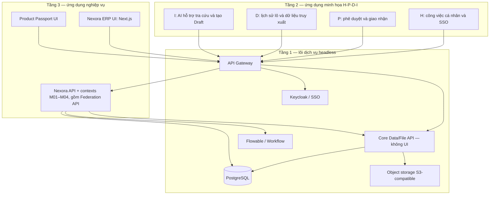

# Kiến trúc Nexora

Nexora là ERP nguồn mở self-hosted, tích hợp truy xuất nguồn gốc và liên thông chuỗi cung ứng (federated). Ứng dụng nghiệp vụ Next.js phục vụ UI và API theo Modular Monolith; lớp dịch vụ DX-OS bên dưới phải cung cấp năng lực headless qua API. Mỗi doanh nghiệp chạy một instance với một PostgreSQL riêng.

Ràng buộc cuộc thi lấy theo đề thi/thể lệ OLP 2026; phạm vi nghiệp vụ lấy theo **Chương 6**; tech stack Nexora lấy theo **Chương 7 §7.12**. Chi tiết: `documents/referents/SOURCE_OF_TRUTH.md`.

## Ánh xạ ba tầng DX-OS (kiến trúc đích)

Sơ đồ thể hiện **trách nhiệm đích**, chưa phải các tiến trình đã triển khai. Theo [phase plan](./documents/phase-plan/README.md), core data/file API là runtime không UI, cung cấp metadata/projection có cấu trúc và tệp có quyền. DX-Lab Operations Workspace là ứng dụng frontend tầng 2 triển khai riêng, gom bốn vùng H/P/D/I; Nexora ERP tầng 3 vẫn sở hữu transaction chứng từ/tồn và business API. Core data API không cho ghi tồn trực tiếp hoặc thay transaction M03. `platform/` là mã tích hợp/port dùng chung trong ứng dụng, không phải bằng chứng tự thân rằng toàn bộ lõi DX-OS đã hoạt động.

## Module MVP

| Mã | Trách nhiệm | Code |
| --- | --- | --- |
| Platform adapter | Access, audit, workflow port, outbox, files, persistence | `platform/` |
| M01 | Tổ chức, user, partner, connection | `contexts/system/` |
| M02 | Product, batch, warehouse, tồn | `contexts/catalog/`, `contexts/inventory/` |
| M03 | Nhập/xuất/chuyển/kiểm kê/bán theo lô | `contexts/trading/` |
| M04 | Trace events, QR, federation | `contexts/traceability/`, `contexts/federation/` |
| AI01 | Tra cứu, draft, cảnh báo rule-based | `services/ai/` |

Thứ tự phụ thuộc: xem `documents/plans/DEPENDENCIES.md`.

## Tech stack (Chương 7.12)

| Lớp | Công nghệ |
| --- | --- |
| UI | Next.js, React, TypeScript, Tailwind, shadcn/ui |
| Biên & định danh | API Gateway nguồn mở (sản phẩm chốt trong plan), Keycloak (OIDC), REST, HTTPS |
| Nghiệp vụ | Next.js Modular Monolith, DDD, PostgreSQL |
| Quy trình & CI | Flowable, GitHub Actions, Docker Compose |
| Dữ liệu & hàng đợi | PostgreSQL, Redis, object storage S3-compatible tự host cho demo; R2 là tùy chọn triển khai ngoài |
| AI | Python, REST, LLM (tool-calling) |
| Quan sát | OpenAPI, Prometheus, Grafana |

## Luật kiến trúc

- `app/` không chứa rule nghiệp vụ.
- `platform/` không chứa tên chứng từ M02–M04.
- Context không import domain của nhau; wire ở `composition/`.
- Confirm chứng từ sở hữu movement: một transaction ghi aggregate + tồn (qua port) + outbox + audit. GoodsIssue trừ tồn; PartnerTransfer/SaleRecord chỉ tham chiếu issue và không trừ lần nữa; ReceivingConfirmation cộng theo actual.
- Nhận federation message không đồng nghĩa đã nhận đủ hàng.
- AI chỉ Draft; người dùng Confirm.
- Không dùng mô hình SaaS `tenant_id` đa tổ chức trên một DB. Chi nhánh/kho là dữ liệu nội bộ của một org.

## PostgreSQL (một instance)

Schema gợi ý: `platform`, `system`, `catalog`, `inventory`, `trading`, `traceability`, `federation`.

## Triển khai

Kiến trúc đích của Docker Compose: ERP app, DX-Lab frontend, core data/file API, API Gateway, PostgreSQL, Redis, Keycloak, object storage, Flowable (và AI service khi bật). **Compose hiện tại chỉ có PostgreSQL**; chưa thể dùng để chứng minh lõi DX-OS hoặc demo ba instance. Demo đích: ba stack A/B/C, DB riêng, chỉ nói chuyện qua Federation API.

## Tài liệu liên quan

- `documents/referents/SOURCE_OF_TRUTH.md`
- `documents/referents/FOLDER_STRUCTURE.md`
- `documents/referents/CODING_RULES.md`
- `documents/referents/OLP_2026_ALIGNMENT.md`
- `documents/plans/*`
- `documents/phase-plan/README.md`
- Đề xuất: `documents/nexora/Nexora - NEU.OPUS5.5.md` (Ch6, Ch7)

## Scaffold lệch (không chuẩn)

Các context cũ kiểu `sales`, `finance`, `procurement`, `master-data` (nếu còn trong repo) không khớp Chương 6. Khi implement, thay bằng cấu trúc đích ở trên; không mở rộng scaffold lệch.
