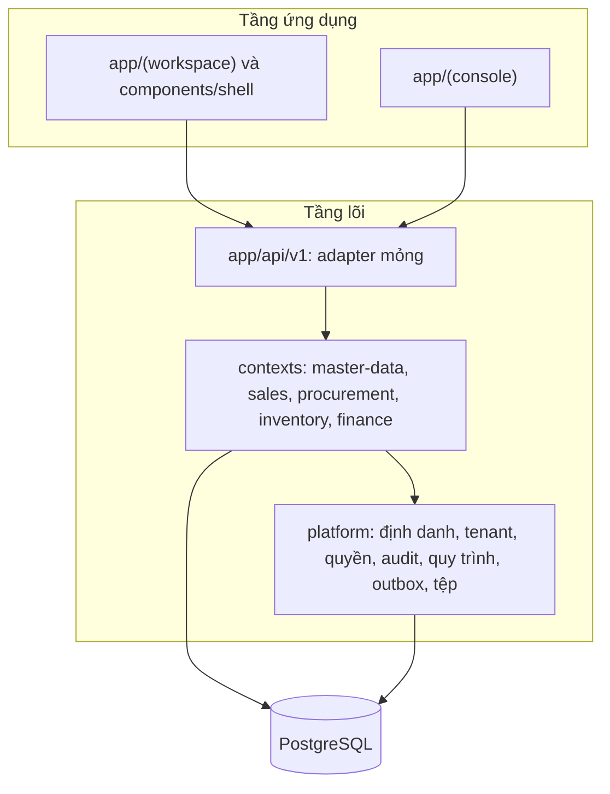
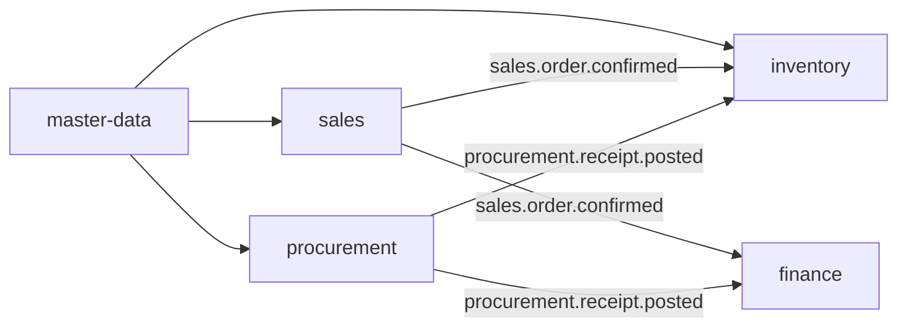

# Kiến trúc Nexora

Nexora là SaaS ERP. Một tiến trình Next.js phục vụ cả giao diện React và API. PostgreSQL là nguồn sự thật. Nghiệp vụ nằm trong bounded context, không nằm trong lõi nền tảng.

Tài liệu này học cấu trúc của [DX-OS](https://github.com/HaUI-ImplSolution/DX-OS) rồi đổi những chỗ không khớp stack và bài toán ERP.

## DX-OS giữ lại những gì

DX-OS chia hệ thống thành ba tầng: lõi không giao diện, ứng dụng dựng từ metadata, và mô hình nghiệp vụ. Lõi không chứa tên thực thể của một lĩnh vực. Một yêu cầu đi theo một đường: xác thực, quyền theo dòng, kiểm quy tắc, rồi ghi dữ liệu, quy trình và lịch sử trong cùng một giao dịch. Trạng thái chỉ đổi bằng hành động của quy trình. Việc gửi ra ngoài đi qua outbox. Nhật ký và chuỗi lịch sử nằm cạnh dữ liệu nghiệp vụ.

Các phạm vi dòng của DX-OS được giữ nguyên: `all`, `read`, `own`, `unit`, `assigned`.

Các chốt poka-yoke được giữ nguyên:

- Người tạo không tự duyệt chứng từ của mình.
- Từ chối hoặc trả lại bắt buộc có lý do.
- Cột trạng thái không sửa bằng lệnh cập nhật thường.
- Giữ chỗ không được vượt sức chứa.
- Khóa idempotency nằm trong cùng giao dịch với việc làm.

## Chỗ đổi cho Next.js, DDD và SaaS

| DX-OS | Nexora |
|---|---|
| Maven: `dx-model`, `dx-core`, `dx-engine`, `dx-monitor` | Thư mục `platform/` và `contexts/` trong một app Next.js. Tách package khi một context cần triển khai riêng. |
| Tệp YAML sinh bảng, vai, API | Aggregate và migration viết tay. ERP có bất biến riêng (tồn kho, công nợ, giá). Khai báo chỉ dùng cho quy trình và quyền. |
| Một cài đặt, schema `m_<mô hình>` | Nhiều tenant. Mọi dòng nghiệp vụ có `tenant_id`. Mỗi context một schema PostgreSQL. |
| Keycloak, APISIX, Flowable, SeaweedFS | Cổng trong `platform/`. OIDC, object storage và máy trạng thái cắm vào cổng đó khi cần. |
| react-admin đọc metadata | App Router, React, Tailwind. Route và component chỉ gọi API công khai của context. |

## Ba tầng trong repo này



`app/` không chứa quy tắc nghiệp vụ. `platform/` không chứa tên đơn hàng, phiếu nhập, hóa đơn. Context không import lẫn nhau. Khi bán hàng cần giữ hàng, nó gọi một cổng do chính sales định nghĩa. Inventory hiện thực cổng đó ở lớp infrastructure.

## Cây thư mục

```text
nexora/
  app/                          Tầng ứng dụng và adapter HTTP
    api/v1/                     Route handler mỏng, một việc một route
    (workspace)/                Sẽ là hộp việc, chứng từ, danh sách
    (console)/                  Sẽ là bảng điều khiển vận hành
  components/shell/             Khung giao diện Tailwind
  composition/                  Bản đồ sự kiện giữa các context. Platform không import thư mục này
  platform/                     Lõi dùng chung, tương đương dx-core
    kernel/                     Lỗi miền, định danh
    identity/                   Actor lấy từ phiên đăng nhập
    tenancy/                    Tenant SaaS
    access/                     Quyền theo dòng
    audit/                      Nhật ký thao tác
    workflow/                   Máy trạng thái dùng chung
    outbox/                     Sự kiện cùng giao dịch
    files/                      Siêu dữ liệu tệp đính kèm
    persistence/                Biên giao dịch
    http/                       Thứ tự một lệnh ghi
  contexts/                     Bounded context, tương đương tầng mô hình nhưng là mã DDD
    master-data/                Đối tác, hàng hóa
    sales/                      Đơn bán
    procurement/                Đơn mua
    inventory/                  Tồn kho và giữ chỗ
    finance/                    Hóa đơn phải thu, phải trả
  db/migrations/                Schema PostgreSQL, nguồn cấu trúc dữ liệu
  deploy/                       Postgres cục bộ
```

Mỗi context có ba lớp:

- `domain/`: aggregate, bất biến, không import Next hay driver SQL.
- `application/`: ca sử dụng và cổng. Chỉ thêm khi có ca sử dụng thật.
- `infrastructure/`: repository, SQL, adapter sang context khác. Thêm cùng migration của context đó.

`index.ts` của context là API công khai. App và context khác chỉ được import file này.

## Bản đồ ngữ cảnh



Master data là upstream. Sales và procurement không sửa tồn kho. Chúng phát sự kiện. Inventory và finance là downstream và tự quyết định cách ghi sổ của mình.

## Một lệnh ghi

Thứ tự trong `platform/http/pipeline.ts`:

1. Xác thực, lấy `Actor`.
2. Khóa tenant. Mọi câu lệnh sau đó đều mang `tenant_id` của actor.
3. Phân quyền theo vai và phạm vi dòng.
4. Kiểm `Idempotency-Key` trước khi làm lại một lệnh đã thành công.
5. Domain kiểm bất biến và hành động quy trình.
6. Một giao dịch PostgreSQL ghi aggregate, lịch sử, audit cần thiết, và outbox.
7. Sau khi commit, dispatcher gửi outbox. Lỗi bên nhận không làm mất nghiệp vụ. Gửi lại được.

Đổi trạng thái đi qua `applyAction`. Lệnh cập nhật trường thường mà đụng `status` bị từ chối.

## PostgreSQL

| Schema | Việc |
|---|---|
| `platform` | Tenant, đơn vị, thành viên, audit, outbox, idempotency, chuỗi lịch sử, tệp |
| `master_data` | Đối tác, hàng hóa |
| `sales` | Đơn bán và dòng hàng |
| `procurement` | Đơn mua và nhận hàng |
| `inventory` | Sổ kho, giữ chỗ |
| `finance` | Hóa đơn và thanh toán |

`db/migrations/0001_platform.sql` tạo schema và bảng lõi. Bảng nghiệp vụ thêm bằng migration của đúng context, luôn có `tenant_id`.

Kết nối ghi của ứng dụng là kết nối duy nhất vào các schema trên. Báo cáo đọc qua vai chỉ đọc, cấp riêng, không đi qua quyền `own` / `unit` của người dùng cuối.

## Giao diện

Khung ứng dụng nằm ở `components/shell/areas.ts`: Hộp việc cho người xử lý, và Bảng điều khiển cho người vận hành. Trang cụ thể thêm khi có ca sử dụng. Danh sách, biểu mẫu và bảng trạng thái đọc quyền từ API. Chúng không tự quyết định ai được duyệt.

## Việc tiếp theo, theo thứ tự

1. Adapter Postgres trong `platform/persistence` và chạy `0001_platform.sql`.
2. Đăng nhập và `Actor` thật, rồi middleware gắn tenant.
3. Context đầu tiên nên là master data, vì sales và kho đều cần hàng hóa và đối tác.
4. Đơn bán khép kín: nháp, trình, duyệt, giữ chỗ, hóa đơn nháp. Mỗi bước một giao dịch và một sự kiện outbox.
