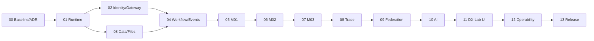

# Bản đồ thực thi Nexora

## Trạng thái xuất phát được kiểm tra

- `package.json`: Next.js 16, React 19, TypeScript, Tailwind; chưa có các dependency nghiệp vụ.
- `app/page.tsx`: trang starter; `app/api/v1/health/route.ts` trả `ok` tĩnh.
- `deploy/docker-compose.yml`: chỉ PostgreSQL; `db/migrations/0001_platform.sql` rỗng.
- `platform/`: type/interface và hàm domain nhỏ; chưa có Keycloak, gateway, Flowable, S3, outbox worker hoặc transaction adapter.
- `contexts/sales|procurement|finance|master-data`: scaffold cũ, không tính là M01–M04. `contexts/inventory` hiện chỉ có reservation guard.
- `LICENSE`, `CHANGELOG.md` và tài liệu kiến trúc đã có; header SPDX từng tệp mã, công khai repo/release/bug tracker vẫn cần xác minh.

## Định nghĩa hoàn thành dự án trong phạm vi này

Một clone sạch có thể dựng hệ thống từ source; ba instance A/B/C với DB riêng hoạt động; A xuất lô cho B, B xác nhận thực nhận và xuất cho C, C bán theo lô và cấp QR; lịch sử liên doanh nghiệp có bằng chứng, quyền công bố; một phê duyệt Flowable thực thi; AI tra cứu và chỉ tạo Draft; ứng dụng H-P-D-I gọi lõi headless; test lỗi, bảo mật, backup/restore và release nguồn mở có thể lặp lại. Chỉ khi toàn bộ `test-matrix.md` pass mới gọi là MVP đạt.

## Đường găng

P02/P03 có thể triển khai độc lập sau P01. UI cơ bản được làm theo từng module P05–P10; P11 hợp nhất luồng và chứng minh ứng dụng tầng 2. P12 có thể bắt đầu nghiên cứu sớm nhưng cần dữ liệu sự kiện thật để nghiệm thu. AI không được đi trước API M02/M03/M04.

## Cổng liên pha

| Gate | Không đi tiếp nếu | Bằng chứng tối thiểu |
| --- | --- | --- |
| G00 | Gateway/storage/DB adapter/định danh, movement ownership và phạm vi demo chưa có ADR | Decision log, hợp đồng API/sự kiện, trace AC |
| G01 | Clone sạch chưa chạy được stack dev hoặc migration chưa lặp lại được | Script bootstrap, health dependency, log cài đặt |
| G02 | Token sai vẫn qua gateway; private route lộ trực tiếp | Bài test 401/403, topology mạng, OIDC flow |
| G03 | Ghi aggregate + audit + outbox không atomic; file chưa cách ly | Integration rollback, upload/download/scan, restore drill |
| G04 | Workflow chỉ là enum TS; retry tạo bản ghi trùng | BPMN deployment, task complete, crash/retry tests |
| G05–G07 | Org/lot/stock/document không có API + DB + auth + UI tối thiểu | Test module, API contract, state và transaction evidence |
| G08–G09 | Trace không liên kết chứng từ hoặc federation phụ thuộc DB chung | A/B/C e2e, offline/retry/dedupe/partial receiving |
| G10–G11 | AI có thể confirm hoặc H-P-D-I chỉ là slide | Adversarial AI tests, UI thật qua gateway |
| G12–G13 | Thiếu 4 nguyên lý DX-OS, tài liệu nguồn mở, release hoặc demo | Ma trận nghiệm thu ký bởi người thực hiện; build/restore/showcase |

## Nguyên tắc cắt việc

Mỗi phần nghiệp vụ đi từ schema → domain invariant → use case/port → adapter → API → UI tối thiểu → test. Với các hành động thay đổi tồn, không cho phép tách “API xong” khỏi transaction, outbox và audit. Với federation, technical ACK không được cập nhật tồn; xác nhận thực nhận là hành động riêng của B/C.

## Rủi ro cấp dự án

| Rủi ro | Dấu hiệu sớm | Xử lý trong plan |
| --- | --- | --- |
| Lõi bị coi là folder `platform/` | Compose chỉ PG; UI/Next API được gọi là PaaS | G02/G04 và demo qua gateway + SSO + storage + Flowable |
| Bị kéo sang ERP đầy đủ | Task mới finance, POS, production | Chương 6 và `SOURCE_OF_TRUTH.md` là giới hạn |
| Lô/stock sai khi retry hoặc song song | Tồn âm, duplicate movement, ACK = receipt | DB constraint, lock, idempotency, outbox/inbox |
| Ba instance chỉ là ba tenant chung DB | Một DB chứa A/B/C | G13 kiểm tra ba DB/credential/volume |
| AI suy diễn dữ liệu và vượt quyền | Trả số liệu không có nguồn, gọi confirm | Tool allowlist, authz, audit, draft-only |
| Mất điểm nguồn mở | Thiếu header, release, cài lại, tracker | P00 và P13 cùng test-matrix |
| Tài liệu cuộc thi có ngày mâu thuẫn | Đề thi ghi 2025, thể lệ ghi 2026 | Xác minh BTC ở P00 trước khi lập lịch |
