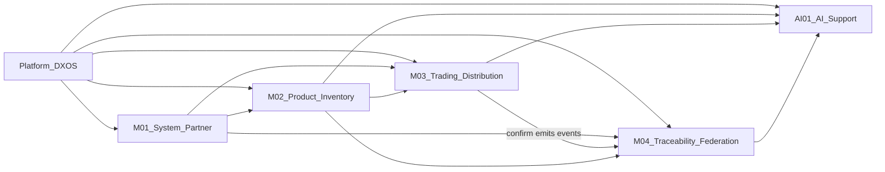

# Phụ thuộc và thứ tự xây dựng module

Task nhỏ, phase gate và ma trận nghiệm thu nằm trong [documents/phase-plan/README.md](../phase-plan/README.md). Tài liệu này giữ quan hệ phụ thuộc ở cấp module.

## Thứ tự sprint đề xuất

1. `00-platform-dxos.md`
2. `M01-system-partner.md`
3. `M02-product-inventory.md`
4. `M03-trading-distribution.md`
5. `M04-traceability-federation.md`
6. `AI01-ai-support.md`

## Quan hệ cung cấp / tiêu thụ

| Module | Phụ thuộc | Cung cấp cho |
| --- | --- | --- |
| Platform | — | Tất cả |
| M01 | Platform | M02, M03, M04 (org, user, partner, connection) |
| M02 | Platform, M01 | M03 (product/lot/warehouse), M04 (định danh lô), AI01 |
| M03 | Platform, M01, M02 | M04 (sự kiện khi confirm), AI01 (draft phiếu) |
| M04 | Platform, M01, M02, M03 | AI01 (lịch sử truy xuất), AC federation |
| AI01 | Platform + API của M02/M03/M04 | Người dùng (tra cứu, draft) |

## Kịch bản demo xuyên module (A → B → C)

1. M01: ba instance, partner connection A–B và B–C.
2. M02: A tạo product + lot + tồn.
3. M03: A xuất (Partner Transfer); B Receiving Confirmation; B xuất cho C; C ghi Sale Record.
4. M04: sự kiện federation + QR passport xuyên chuỗi.
5. AI01: hỏi lịch sử lô; tạo draft phiếu trên một instance.
